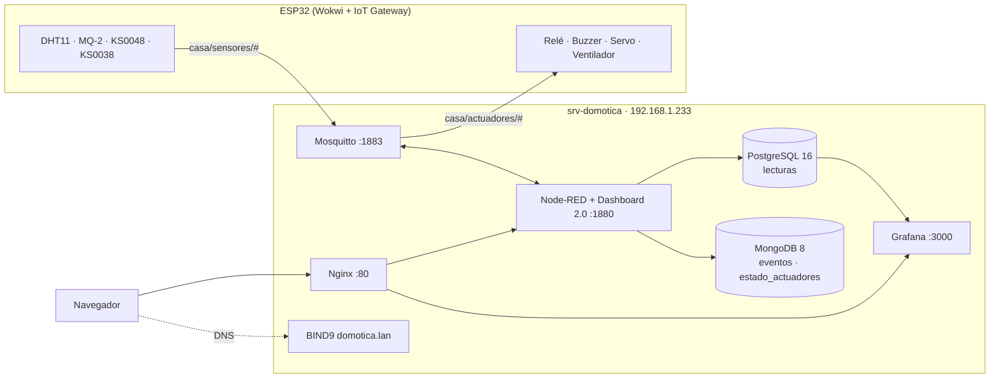

# Sistema domótico IoT centralizado · ACO941

Proyecto integrador de **Arquitectura de Computadoras (ACO941, grupo G01T)** · Universidad Don Bosco · Ciclo 02-2026.

Un ESP32 con **4 sensores y 4 actuadores** se comunica por **MQTT** con un servidor propio (máquina virtual Ubuntu Server). Ahí **Node-RED** muestra un dashboard web de monitoreo y control, guarda el histórico en **PostgreSQL** y los eventos en **MongoDB**, y **Grafana** grafica las tendencias. Todo corre en infraestructura propia: no se usa ninguna plataforma IoT externa.

## Arquitectura

## Fases del proyecto

| Fase | Contenido | Documento |
|---|---|---|
| 1 | Presupuesto de la infraestructura | [PDF](docs/Fase1_Presupuesto_infraestructura.pdf) |
| 2 | Diseño conceptual del sistema domótico | [PDF](docs/Fase2_Diseno_conceptual.pdf) |
| 3 | Implementación de la infraestructura del servidor | [PDF](docs/Fase3_Implementacion_servidor.pdf) |
| 4 | Implementación y despliegue del sistema domótico | Este repositorio |

## Estructura del repositorio

| Carpeta | Contenido |
|---|---|
| [`esp32/`](esp32) | Programa del ESP32 (`sketch.ino`), circuito de Wokwi (`diagram.json`), plantilla de credenciales |
| [`nodered/`](nodered) | Flujo de Node-RED y dashboard (`flows.json`) |
| [`sql/`](sql) | Esquema de PostgreSQL, usuario de Grafana y consultas |
| [`mongodb/`](mongodb) | Colecciones, índices y usuario de MongoDB |
| [`grafana/`](grafana) | Consulta del panel de temperatura |
| [`servidor/`](servidor) | Configuración de la Fase 3: red, DNS, firewall, Mosquitto, Nginx, etc. |
| [`docs/`](docs) | Documentos de las fases y capturas |

## Hardware

| Sensor | Mide | GPIO | Actuador | Acción | GPIO |
|---|---|---|---|---|---|
| DHT11 | Temperatura y humedad | 15 | Relé + foco 110 V | Luz de alarma | 26 |
| MQ-2 | Gas / humo | 34 | Buzzer activo | Sirena | 25 |
| KS0048 | Fuga de agua | 35 | Servo SG90 | Cierra la válvula (90°) | 18 |
| KS0038 | Puerta abierta/cerrada | 27 | Ventilador DC | Extracción de aire | 19 |

Extras: botón físico de modo seguridad (GPIO 14) y LED de estado MQTT (GPIO 2).

## Reglas de control (modo automático)

| Condición | Actuadores |
|---|---|
| Temperatura > 30 °C (se apaga bajo 29 °C, histéresis) | Ventilador |
| Gas sobre el umbral calibrado al arrancar | Buzzer + ventilador |
| Agua > 30 % | Buzzer + servo a 90° |
| Puerta abierta **y** modo seguridad activo | Buzzer + relé |

En **modo manual** los actuadores obedecen al dashboard, pero las alarmas de gas y agua siguen actuando por seguridad.

## Tópicos MQTT

| Tópico | Sentido | QoS / retención |
|---|---|---|
| `casa/sensores/{temperatura,humedad,gas,agua,puerta}` | ESP32 → servidor | QoS 0, cada 5 s |
| `casa/estado/esp32` | ESP32 → servidor | QoS 1, retenido, **LWT** `offline` |
| `casa/estado/actuadores` | ESP32 → servidor | Retenido (JSON) |
| `casa/estado/eventos` · `casa/estado/errores` | ESP32 → servidor | QoS 0 (JSON) |
| `casa/actuadores/{rele,buzzer,ventilador,servo,modo,seguridad}` | Dashboard → ESP32 | QoS 1, sin retener |

Mosquitto exige usuario y contraseña, y una ACL limita a cada cliente: el ESP32 solo escribe sensores y estado, y solo lee órdenes.

## Manejo de errores

- **ESP32:** reconexión WiFi y MQTT sin bloquear (las reglas siguen funcionando sin red), validación de rangos, órdenes inválidas rechazadas y reportadas en `casa/estado/errores`, LWT si el nodo se cae.
- **Node-RED:** segunda validación de rangos antes de guardar, `INSERT` parametrizado, vigilancia de 20 s sin datos, aviso de desconexión del ESP32, nodos `catch` para errores de bases de datos.

## Cómo ejecutarlo

1. **Servidor:** seguir la Fase 3 ([`servidor/`](servidor), [`sql/`](sql), [`mongodb/`](mongodb)).
2. **Node-RED:** importar [`nodered/flows.json`](nodered) y escribir las credenciales en los nodos de configuración.
3. **ESP32:** ver [`esp32/README.md`](esp32/README.md). Hay que copiar `secrets.example.h` como `secrets.h`, compilar en wokwi.com y simular en VS Code con el IoT Gateway.
4. Abrir `http://dashboard.domotica.lan/dashboard/inicio`.

## Seguridad del repositorio

No hay contraseñas en el repositorio. `secrets.h`, el firmware `.bin`, `flows_cred.json` y `passwd` están en [`.gitignore`](.gitignore).

## Avance

| Actividad de la Fase 4 | Avance |
|---|---|
| Sistema IoT (4 sensores, 4 actuadores) | 100 % |
| Comunicación MQTT con manejo de errores | 100 % |
| Dashboard en la infraestructura propia | 100 % |
| Simulación funcional (Wokwi) | 100 % |
| Repositorio Git | 100 % |
| Documento final con evidencias | En elaboración |
| Presentación final | Pendiente |

## Equipo

| Nombre | Carnet |
|---|---|
| Katherine Gissell García Sánchez | GS222376 |
| Carlos Francisco Peña Herrera | PH203126 |
| José Rolando Álvarez Mejía | AM232553 |
| Bryan Steven Cornejo Zavala | CZ220876 |
| Kevin Adonay Martinez Ceron | MC200314 |
